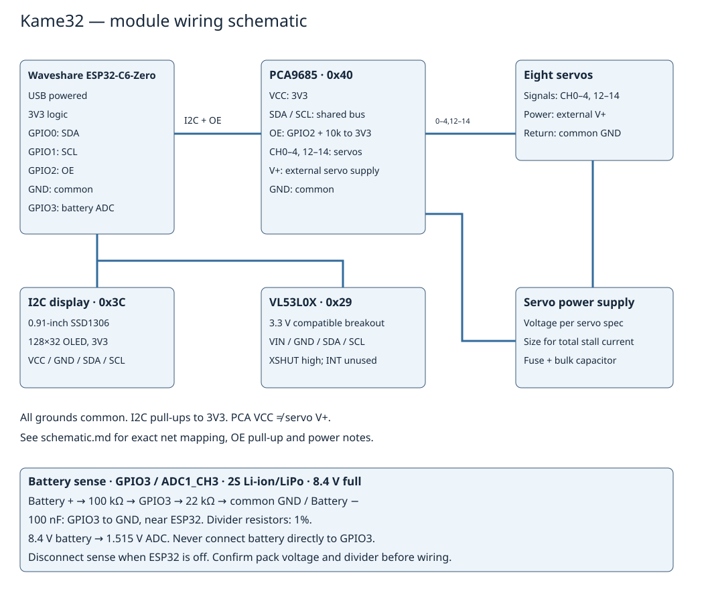

# Module wiring schematic

This is a module-level wiring schematic, not a PCB fabrication design.
GPIO numbers refer to ESP32-C6 GPIO labels, not header positions.



```text
  USB supply                         External regulated servo supply
      |                              (voltage per servo specification)
  +---v----------------+                       +          -
  | ESP32-C6-Zero      |                       |          |
  |                   |     +------------------|----------|---+
  | 3V3 --------------+-----| VCC              V+        GND  |
  | GND --------------+-----| GND        PCA9685 module       |
  | GPIO0 SDA --------+-----| SDA                             |
  | GPIO1 SCL --------+-----| SCL                             |
  | GPIO2 ------------+-----| OE                              |
  +-------------------+     | CH0-4,12-14 -------> servo S     |
      |  |  |  |            | V+ rail ----------> servo +     |
     3V3 | SDA SCL          | GND rail ---------> servo -     |
      | GND |  |            +----------------------------------+
      |  |  |  |                        |
   +--+--+--+--+---------+              OE --[10k]-- 3V3
   | VCC GND SDA SCL     |
   | SSD1306 128x32 I2C  |   0x3C (0.91-inch OLED)
   +---------------------+
      |  |  |  |   Shared 3V3 / GND / SDA / SCL
   +--+--+--+--+---------+
   | VIN GND SDA SCL     |
   | VL53L0X breakout    |   0x29
   +---------------------+
```

| ESP32-C6 | PCA9685 | Display | VL53L0X breakout | Other |
| --- | --- | --- | --- | --- |
| 3V3 | VCC logic | VCC | VIN/VCC (3.3 V compatible module) | OE pull-up to 3V3 |
| GND | GND | GND | GND | Servo supply negative/common ground |
| GPIO0 | SDA | SDA | SDA | I2C pull-ups to 3V3 only |
| GPIO1 | SCL | SCL | SCL | I2C pull-ups to 3V3 only |
| GPIO2 | OE | — | — | 10 kΩ pull-up to 3V3 |
| — | V+ | — | — | External servo supply positive |

Use a VL53L0X breakout rated for a 3.3 V supply and 3.3 V I2C logic,
not the bare sensor. The default 7-bit address is 0x29, alongside the PCA9685
at 0x40 and OLED at 0x3C. XSHUT may remain unconnected only if the breakout
pulls it high; otherwise pull it to the breakout's specified logic rail.
GPIO1/INT on the sensor is unused; measurement readiness is polled over I2C.
No extra ESP32 GPIO is required. Check the breakout pin labels before wiring.

PCA address straps A0–A5 are low (0x40). The eight servos use channels 0–4 and 12–14; channels 5–11 and 15 stay off.
Each servo uses its channel signal pin plus V+ and GND; confirm connector polarity on your module.
PCA VCC is logic power, V+ is the separate servo power rail. Do not power eight
servos from USB or the ESP32 3V3 regulator. Size the supply, wiring and fuse
for the combined servo stall current. Put a bulk capacitor (for example
470–1000 µF, suitably voltage rated) across V+/GND near the PCA board.

Check whether your PCA module ties OE to ground: remove such a tie before
using GPIO2 and the external pull-up. The pull-up keeps outputs disabled while
the ESP32 resets. Use short I2C wires and an effective pull-up around 4.7 kΩ
on SDA and SCL; modules may already have pull-ups in parallel. Keep servo
return currents out of the ESP32/display ground wiring. Servo supply positive
is not connected to the ESP32 USB/5V rail in this design.

## Battery voltage measurement

GPIO3 (ADC1_CH3) measures the battery through an external resistor divider.
The battery is **2S**, assumed to be standard Li-ion/LiPo with a maximum of
**8.4 V fully charged** (4.2 V per cell). The divider below is sized for this
pack. Confirm the chemistry and charge limit before connecting it; change the
divider and firmware values together for other voltage ranges.

```text
Battery + ----[100 kΩ, 1%]----+---- GPIO3 (ADC1_CH3)
                             |
                        [22 kΩ, 1%]
                             |
Battery - -------------------+---- ESP32 GND
                             |
GPIO3 -----------||---------- GND
                100 nF
```

The 100 nF ceramic capacitor is directly between GPIO3 and GND, near the ESP32.
At 8.4 V the nominal ADC input is 1.515 V. Firmware conservatively rejects
samples at or above 2.4 V at the ADC input; that check cannot protect the pin
from overvoltage. Never connect battery positive directly to GPIO3. Keep the
ADC input below 3.3 V, including resistor tolerances and transients. Disconnect
battery sensing when the ESP32 is unpowered to avoid back-powering through GPIO3.
Battery negative joins common ground; route the sensing ground away from servo
return currents. This sensing connection does not supply power to the ESP32.

Set `BatteryTopOhms`, `BatteryBottomOhms` and `BatteryCalibration` in
`include/config.h` to match the installed divider. Conversion is
`Vbattery = Vadc × (Rtop + Rbottom) / Rbottom × calibration`.
The firmware uses calibrated `analogReadMilliVolts` with 11 dB attenuation;
see [Espressif's ADC API](https://docs.espressif.com/projects/arduino-esp32/en/latest/api/adc.html).
With no battery attached a fitted divider reads near zero; firmware cannot
detect a missing divider, and a floating GPIO can report arbitrary voltage.

## Waveshare ESP32-C6-Zero module pinout

The table uses the connector signal numbering in the
[Waveshare schematic](https://files.waveshare.com/wiki/ESP32-C6-Zero/ESP32-C6-Zero-Sch.pdf).
These are connector references, not ESP32 chip package pin numbers. For physical
pad positions and orientation, use the manufacturer's
[pinout diagram](https://docs.waveshare.com/ESP32-C6-Zero#pinout-definition).

Top/component view, USB connector at the top:

```text
              USB-C
          ┌───────────┐
   5V   1 │           │ 18  GPIO16 / TX
   GND  2 │           │ 17  GPIO17 / RX
   3V3  3 │           │ 16  GPIO14
 GPIO0  4 │           │ 15  GPIO15
 GPIO1  5 │           │ 14  GPIO18
 GPIO2  6 │           │ 13  GPIO19
 GPIO3  7 │           │ 12  GPIO20
 GPIO4  8 │           │ 11  GPIO21
 GPIO5  9 │           │ 10  GPIO22
          └───────────┘
```

| Connector reference | Board signal | Use in this project / function |
| --- | --- | --- |
| 1 | 5V | Board 5 V power rail; USB/external power isolation must be checked before combining supplies |
| 2 | GND | Common ground |
| 3 | 3V3 | Regulated logic supply to PCA9685 VCC, display and VL53L0X breakout |
| 4 | GPIO0 | I2C SDA |
| 5 | GPIO1 | I2C SCL |
| 6 | GPIO2 | PCA9685 OE; external 10 kΩ pull-up to 3V3 |
| 7 | GPIO3 | Battery voltage divider midpoint; ADC1_CH3 |
| 8 | GPIO4 | Unused; strapping / JTAG pin |
| 9 | GPIO5 | Unused; strapping / JTAG pin |
| 10 | GPIO22 | Unused |
| 11 | GPIO21 | Unused |
| 12 | GPIO20 | Unused |
| 13 | GPIO19 | Unused |
| 14 | GPIO18 | Unused |
| 15 | GPIO15 | Unused; strapping pin |
| 16 | GPIO14 | Unused |
| 17 | RX / GPIO17 | UART0 RX; unused |
| 18 | TX / GPIO16 | UART0 TX; unused |

Additional schematic test points: GPIO6, GPIO7, GPIO8, GPIO9, GPIO23,
and USB D+ / D− (GPIO13 / GPIO12). GPIO8 drives the onboard WS2812 RGB LED, used for startup indication;
GPIO9 connects to BOOT. Neither is used for this project's I2C bus.
GPIO4, GPIO5, GPIO8, GPIO9 and GPIO15 are
[boot strapping pins](https://docs.espressif.com/projects/esp-idf/en/stable/esp32c6/api-reference/peripherals/gpio.html);
external circuitry must preserve their required reset levels.

GPIO signals use 3.3 V logic; do not apply 5 V to them. The onboard regulator
is ME6217C33M5G; do not assume regulator markings or removal instructions from
another board apply. This diagram assumes an unmodified board powered through
USB and a separate servo supply. Battery charging and simultaneous USB/external
power require a separately verified power-path design.

Waveshare has shipped different flash revisions. The firmware deliberately
uses a 4 MB partition layout, including on newer 8 MB modules. See the
[current board documentation](https://docs.waveshare.com/ESP32-C6-Zero)
for the module overview and revision specifications.
